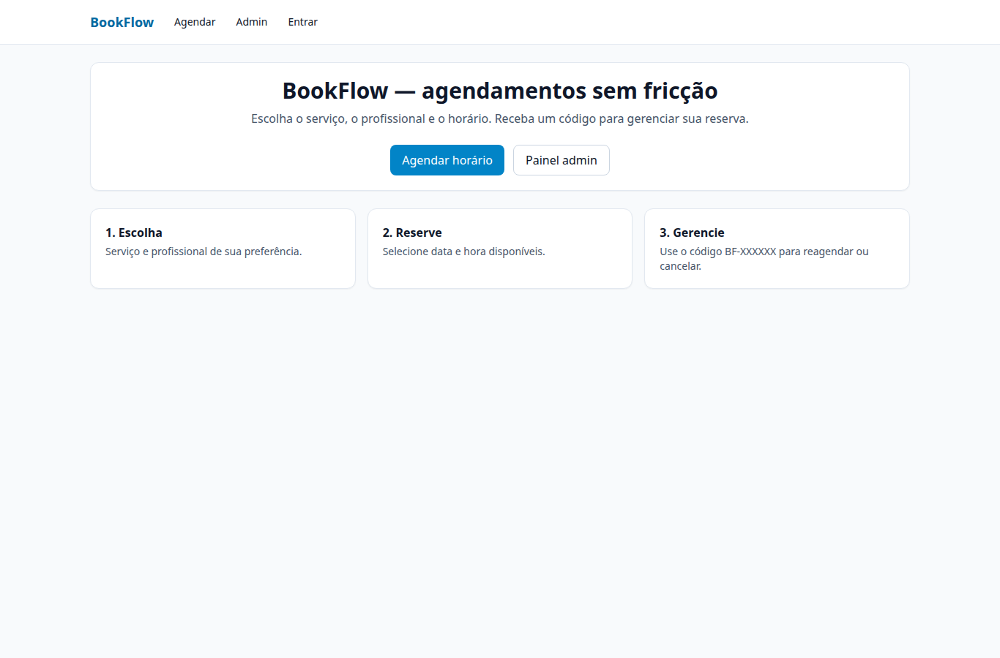
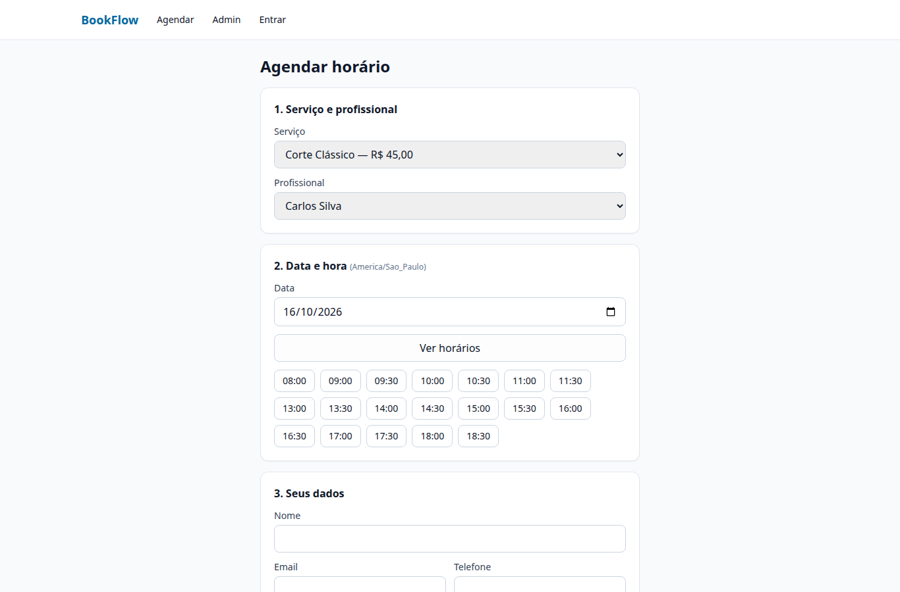
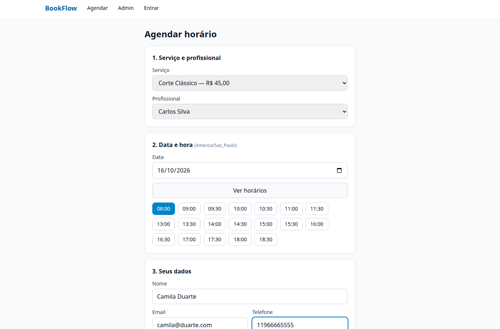
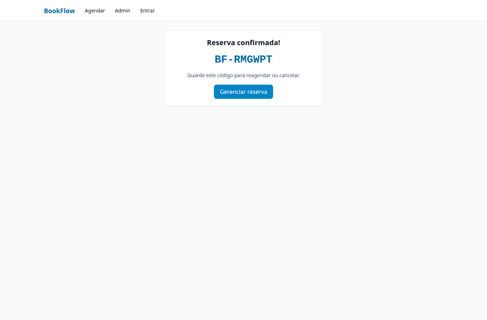
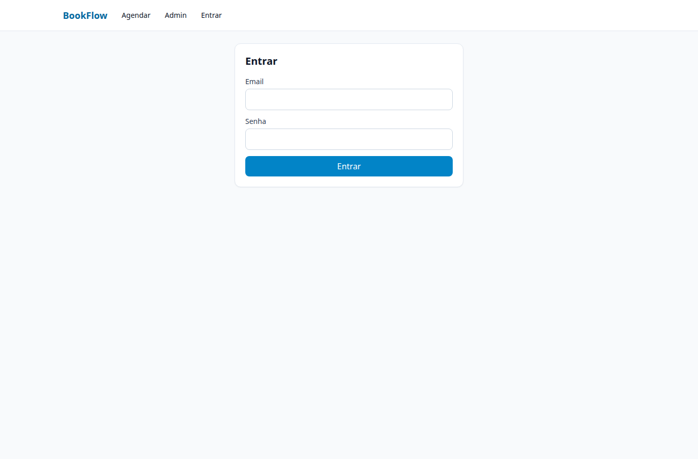
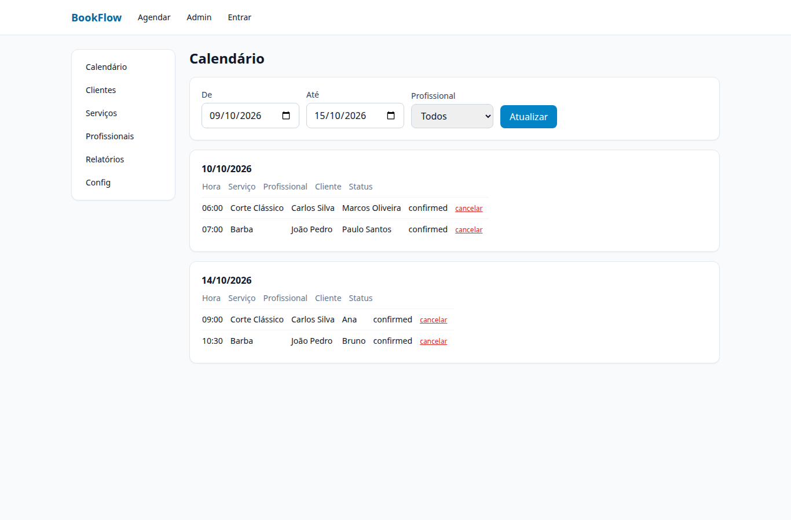
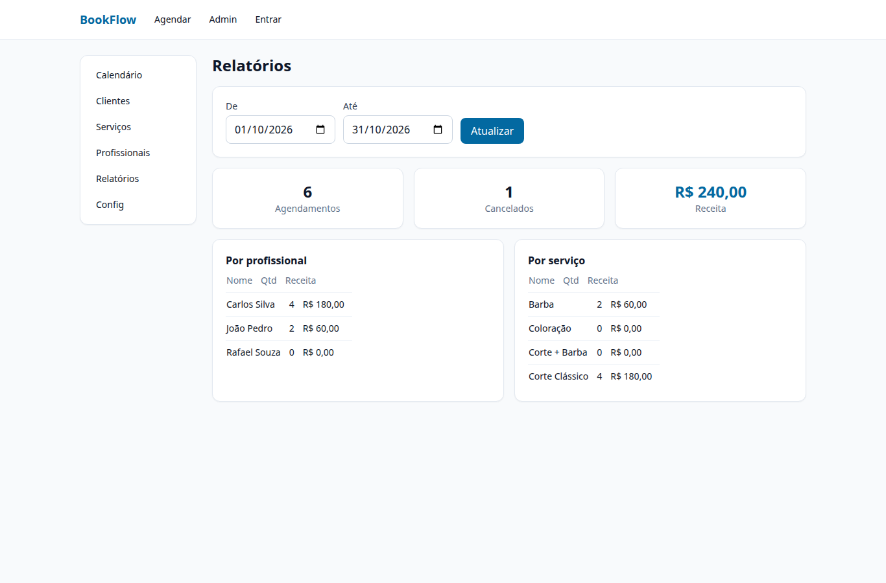

# BookFlow — Agendamentos (Go + Next.js + Postgres)

BookFlow é um sistema multi-tenant de agendamentos: profissionais, serviços,
horários de trabalho, bloqueios, clientes, links públicos de reserva e
calendário/relatórios de admin. Backend em monólito modular Go (Chi + pgx);
frontend em Next.js; Postgres 16 como banco.

## Quickstart

```bash
cp .env.example .env
docker compose up --build
```

- API: http://localhost:8085 (`GET /healthz`, `GET /openapi.yaml`)
- Web: http://localhost:3005
- Postgres (host): localhost:5438

Login seed: `admin@cortefino.com` / `admin123` (org "Barbearia Corte Fino",
3 profissionais, 4 serviços, expediente seg–sáb). Migrations em
`backend/migrations/` (via service `migrate` do compose ou psql); seed em
`0002_seed.sql`.

## Endpoints (prefixo `/api/v1`)

- Auth: `POST /auth/register`, `POST /auth/login`, `POST /auth/refresh`, `GET /auth/me`
- Profissionais: `GET/POST /professionals`, `GET/PATCH/DELETE /professionals/{id}`
- Serviços: `GET/POST /services`, `GET/PATCH/DELETE /services/{id}`
- Horários: `GET/POST /working-hours?professional_id=`, `DELETE /working-hours/{id}`
- Bloqueios: `GET/POST /blocks?professional_id=`, `DELETE /blocks/{id}`
- Clientes: `GET/POST /customers`, `GET/PATCH /customers/{id}`
- Disponibilidade: `GET /availability?professional_id=&service_id=&date=AAAA-MM-DD`
- Catálogo público (sem auth, alimenta `/book`): `GET /public/orgs`,
  `GET /public/services?org_id=`, `GET /public/professionals?org_id=`,
  `GET /public/availability?professional_id=&service_id=&date=AAAA-MM-DD`
- Reservas públicas (sem auth): `POST /bookings/public`, `GET /bookings/public/:code`,
  `POST /bookings/public/:code/reschedule`, `POST /bookings/public/:code/cancel`
- Agendamentos (auth): `GET /appointments`, `POST /appointments`,
  `POST /appointments/:id/reschedule`, `POST /appointments/:id/cancel`
- Admin: `GET /admin/calendar`, `GET /admin/reports`, `GET/PATCH /admin/settings`
- Misc: `GET /healthz`, `GET /openapi.yaml`

Sucesso: `{"data": ...}` (+ `"meta"` opcional). Erros:
`{"error":{"code":"...","message":"..."}}`.

## Regras

- Dinheiro em **centavos** (inteiro, nunca float).
- Horários salvos em UTC (`timestamptz`); cada profissional tem `timezone`
  (padrão `America/Sao_Paulo`); conversão no backend.
- Conflito de slot: só uma reserva vence por profissional/faixa
  (exclusion constraint ou lock transacional) — perdedor recebe `409 SLOT_TAKEN`.
- Cancelar exige >= `cancel_min_hours` (padrão 2h) de antecedência, senão `422 CANCEL_TOO_LATE`.
- Remarcar exige >= `reschedule_min_hours` (padrão 4h), senão `422 RESCHEDULE_TOO_LATE`.
- Acesso público usa o `code` do agendamento (ex. `BF-XXXXXX`).
- Escopo por tenant: login retorna `orgs[]`; o frontend salva `orgs[0].id`
  em `localStorage` (`bookflow_org_id`) e envia `X-Org-ID` + `X-User`.

## Screenshots (reais, stack local)









## Estrutura

- `backend/` — API Go, migrations em `backend/migrations/`, spec em `backend/openapi.yaml`
- `web/` — frontend Next.js
- `docs/ARCHITECTURE.md` — módulos, timezone, concorrência, multi-tenancy

Versão em inglês: `README.md`. Licença: MIT.
